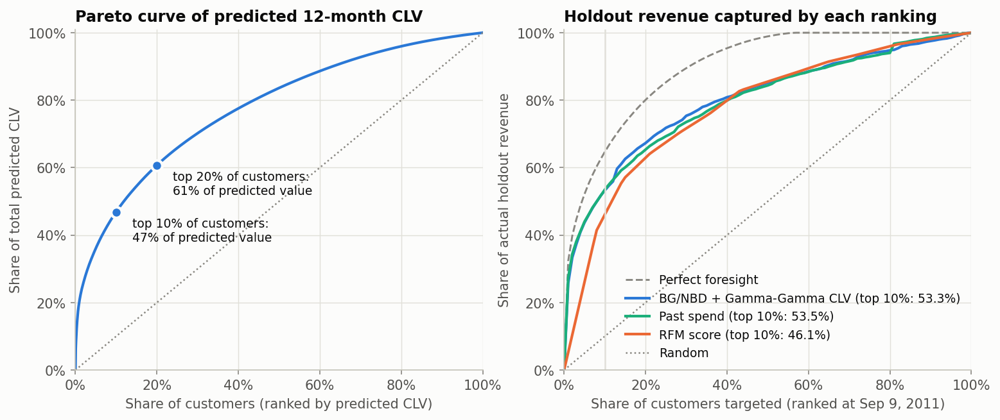
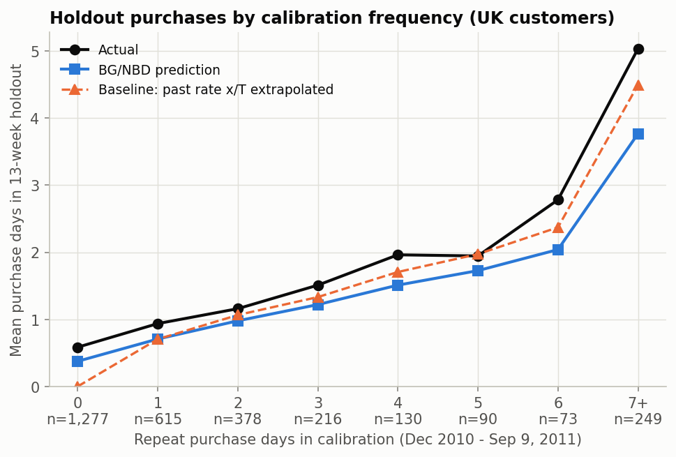
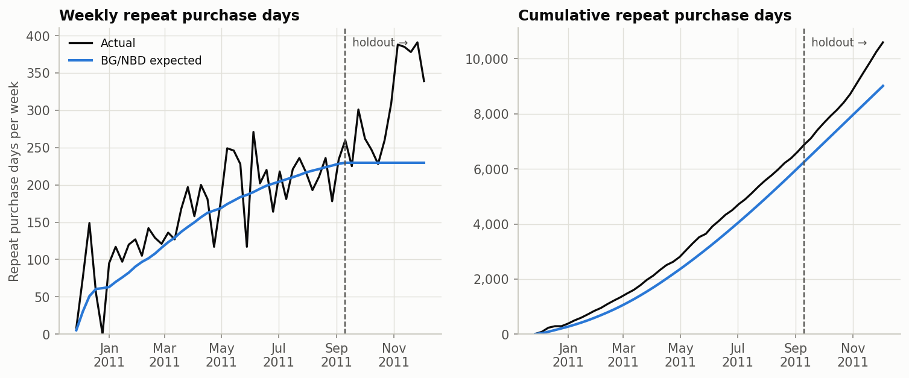
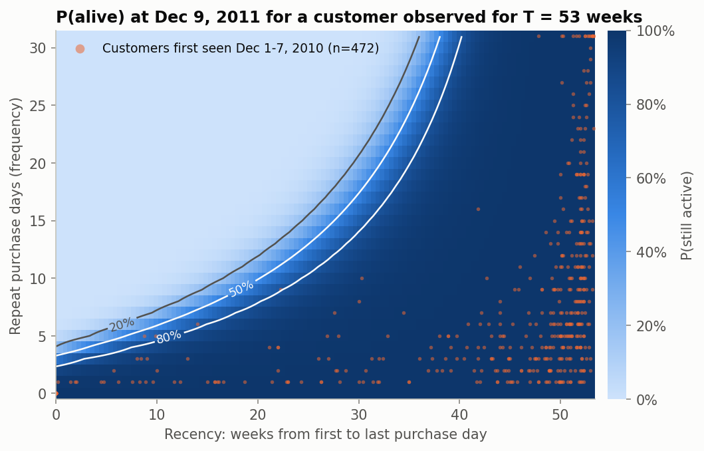

# Customer Lifetime Value: BG/NBD + Gamma-Gamma from scratch

Predicting how often each customer will buy and how much they will spend, with probabilistic
"buy-till-you-die" models written from the papers' equations, tested on a calibration/holdout
split of real e-commerce transactions (541,909 invoice lines) and turned into segment-level
actions.

[](https://github.com/faiqrasulov/customer-lifetime-value/actions/workflows/ci.yml)

[](LICENSE)

## Key results

UK customers of an online gift wholesaler (UCI Online Retail). Models fitted on Dec 1, 2010 -
Sep 9, 2011 and scored on the next 13 weeks (Sep 10 - Dec 9, 2011): 3,028 customers, 3,973
purchase days and GBP 2.14M of revenue in the holdout. All numbers come from `make run` and are
stored in [`reports/metrics.json`](reports/metrics.json).

| Holdout check | BG/NBD (+ Gamma-Gamma) | Past-rate baseline | RFM baseline |
|---|---:|---:|---:|
| Purchase days per customer: MAE | 0.931 | **0.903** | 1.024 |
| Purchase days per customer: RMSE | **1.444** | 1.449 | 1.802 |
| Purchase days per customer: Pearson r | **0.775** | 0.751 | 0.536 |
| Revenue per customer: Pearson r | 0.813 | **0.821** | 0.268 |
| Share of holdout revenue from the top 10% ranked customers | 53.3% | 53.5% (past spend) | 46.1% (RFM score) |
| Total purchase days, predicted vs actual (Q4 holdout) | -24.9% | -29.2% | -17.8% |
| Same, summer holdout of equal length (Jun 11 - Sep 9) | +6.6% | -3.2% | +31.6% |

- **Ranking customers:** the model's 12-month CLV puts customers holding 53.3% of holdout
  revenue in its top 10%, against 46.1% for the RFM score and 64.7% for perfect foresight. It
  ties with simply ranking by past spend (53.5%).
- **Forecasting volume:** per-customer accuracy is on par with extrapolating each customer's
  past purchase rate, and clearly better than RFM-cell averages. Outside the Christmas season the
  aggregate forecast is within +6.6%; in the Sep-Dec gift season it is 24.9% low, because the
  model assumes stationary purchase rates.
- **Churn is not visible in this data:** the BG/NBD dropout process improves the log-likelihood
  by 0.21 on the full year (2 extra parameters) and by 0.00 on the calibration period, so the
  model collapses to "slow buyers, not lost buyers". In the full-year fit P(alive) is at least 0.64
  for every customer; in the holdout, 53% of the customers RFM labelled "At risk" on Sep 9 bought
  again without any campaign.
- **Value concentration:** the top 20% of customers by predicted 12-month CLV hold 60.7% of
  predicted value (top 10%: 46.8%). At an assumed 25% margin a newly acquired customer is worth
  about GBP 491 of margin in the first 12 months, a ceiling for 12-month-payback acquisition cost.



## Problem & why it matters

Marketing budgets, retention spend and the maximum affordable cost of acquiring a customer all
depend on two questions: *which customers are valuable* and *which of them are still active*.
RFM scoring, the usual retail answer, ranks customers by recency, frequency and spend, but it
does not forecast: it cannot say how many orders a "Champion" will place next quarter, what a
new customer is worth, or how much of a segment's silence is churn rather than a long gap
between orders.

In a non-contractual business (no subscription ends when a customer leaves) churn is never
observed directly. The BG/NBD and Gamma-Gamma models (Fader, Hardie & Lee 2005) handle this
with a small, interpretable probabilistic model of purchasing, dropout and spend, and produce
per-customer forecasts that can be checked against a holdout period. This repository builds
them from the equations, checks the implementation against simulations with known answers, and
then checks the forecasts against what customers actually did.

## Approach

**Data and cleaning** (`data.py`, `cleaning.py`). The UCI zip is downloaded once; the 23 MB xlsx
is streamed with openpyxl in read-only mode (peak about 240 MB, 15 s) and cached as parquet.

| Step | Rows in | Removed | Rows out | Rule and reason |
|---|---:|---:|---:|---|
| raw | 541,909 | 0 | 541,909 | invoice lines, Dec 1, 2010 - Dec 9, 2011 |
| missing customer | 541,909 | 135,080 | 406,829 | no CustomerID: cannot be attributed |
| cancellations | 406,829 | 8,905 | 397,924 | invoices starting with "C"; each line is first netted against the latest earlier purchase of the same customer and StockCode (2,657 full returns, 4,814 partial, 1,434 unmatched: bought before Dec 2010 or a different quantity) |
| fully returned | 397,924 | 2,657 | 395,267 | purchase lines whose whole quantity came back; partial returns keep the net quantity |
| non-positive | 395,267 | 40 | 395,227 | zero unit price (free items) |
| non-product | 395,227 | 1,496 | 393,731 | StockCodes that are not merchandise: POST, DOT, C2 (carriage), M (manual), BANK CHARGES, PADS |
| extreme lines | 393,731 | 0 | 393,731 | guard: > 10,000 units or > GBP 10,000 in one line |
| country | 393,731 | 41,875 | 351,856 | United Kingdom only |

Two choices need a word:
- **Outliers.** The famous 80,995-unit and 74,215-unit orders were cancelled within minutes;
  return netting removes them, so the extreme-line guard finds nothing left to remove (the
  largest remaining line is GBP 7,145). Large wholesale *customers* are kept on purpose:
  they are real and they are exactly the customers CLV should find. Dropping them would make
  the error metrics look better and the value concentration look smaller.
- **UK only.** The UK is 89% of clean lines and 3,909 of 4,324 customers. Overseas customers
  are mostly distributors with different order sizes and shipping costs; one market is closer to
  the models' assumption of a single population. As a sensitivity check the main split was rerun
  on all countries: the conclusions do not change (BG/NBD Pearson r 0.795 vs 0.742 for the past
  rate, aggregate -25.3%, top-decile capture 55.6% vs 56.0% for past spend and 48.9% for RFM).

**Customer summary** (`summary.py`), in the Fader-Hardie convention with weeks as the time unit.
A transaction is a customer *purchase day* (two invoices on one day count once). Per customer:
`frequency` x = repeat purchase days, `recency` t_x = weeks from first to last purchase day,
`T` = weeks from first purchase to the end of calibration, `monetary_value` = mean spend of the
repeat purchase days (the first purchase is excluded, as in the paper).

**RFM baseline** (`rfm.py`). Quintile scores for recency, frequency (purchase days) and total
spend; ties share the lowest score of their block, so every single-purchase customer has F = 1.
Named segments use the standard R x F grid (Champions, Loyal customers, At risk, Hibernating ...).

**BG/NBD** (`bgnbd.py`, Fader, Hardie & Lee 2005). Purchase rates follow Gamma(r, alpha) across
customers; after every repeat purchase a customer drops out with probability p ~ Beta(a, b).
- Log-likelihood (eq. 6) in log space with `gammaln`/`betaln` and `logaddexp`, fully vectorised.
- MLE over log-parameters with L-BFGS-B, plus a restart; convergence is also judged by the
  projected gradient, because on this data the optimiser walks along a flat ridge (see below).
- Standard errors from a central-difference Hessian in log space, mapped back with the delta
  method.
- `conditional_expected_transactions` (eq. 10) and `p_alive` (eq. 13). The 2F1 in eq. 10 is
  rewritten with Euler's transformation, `(1-z)^(a-1) 2F1(a+b-1-r, a-1; a+b+x-1; z)`, so its
  parameters do not grow with x; the printed form overflows for heavy buyers over long horizons
  (tested against mpmath).
- A nested no-dropout model (p = 0) to measure how much the dropout process adds.

**Gamma-Gamma** (`gamma_gamma.py`, Fader, Hardie & Lee 2005; Fader & Hardie 2013). Transaction
values ~ Gamma(p, nu), with nu ~ Gamma(q, gamma) across customers; the posterior mean spend
`p (gamma + x m) / (p x + q - 1)` shrinks each customer's average towards the population mean,
less so the more purchases they have. Fitted on repeat customers only. The model assumes spend
is independent of frequency; the observed correlation is weak (Pearson 0.076, Spearman 0.185 on
1,751 repeat customers in calibration; 0.108 / 0.214 on the full year).

**CLV** (`value.py`). Expected purchases in each of the next 12 months x expected spend x
margin, discounted monthly: `CLV = margin * E[M] * sum_k (E[Y(k months)] - E[Y(k-1 months)]) / (1+d)^k`.
Assumptions, stated rather than estimated: **gross margin 25%** (the data have no costs; it
scales every CLV linearly and changes no ranking) and **10% annual discount rate** (0.797% per
month).

**Validation** (`evaluation.py`, `pipeline.py`). Two baselines that use only calibration data:
- *Past rate*: x / T extrapolated over the holdout; revenue = that x the customer's past mean
  spend per purchase day.
- *RFM-cell mean*: RFM scores computed 13 weeks before the end of calibration; the mean number of
  purchase days (and revenue) in the following 13 weeks is recorded per RFM total score (3-15)
  and then looked up with each customer's score at the end of calibration. No holdout data leak
  into it.
- Top-decile capture splits ties at the cut-off pro rata, so the coarse 3-15 RFM score is not
  helped or hurt by an arbitrary tie order.

**Why everything is from scratch.** The point is to own the likelihoods: knowing that eq. 10
needs a hypergeometric function, why P(alive) is exactly 1 for one-time buyers, and why the fit
lands on a ridge here is what makes the results interpretable. **Tests** (50, about 3 s)
compare the closed-form likelihoods with direct numerical integration over the mixing
distributions, compare eq. 10 with the printed formula, a 1-D quadrature and mpmath, recover
known parameters from customers *simulated* from both generative processes (|z| < 3.5 using the
Hessian SEs), match expected purchases and P(alive) to Monte Carlo, and run the whole pipeline
on synthetic invoices.

## Results

### Holdout accuracy

Main split: calibration Dec 1, 2010 - Sep 9, 2011 (40.4 weeks), holdout Sep 10 - Dec 9, 2011
(13 weeks); 3,028 UK customers first seen in calibration, 1,751 of them repeat buyers; 56.9%
bought in the holdout.

| Purchase days in holdout | MAE | RMSE | Pearson r | Spearman | Total predicted vs actual |
|---|---:|---:|---:|---:|---:|
| BG/NBD | 0.931 | 1.444 | 0.775 | 0.489 | 2,985 vs 3,973 (-24.9%) |
| Past rate x/T | 0.903 | 1.449 | 0.751 | 0.495 | 2,814 vs 3,973 (-29.2%) |
| RFM-cell mean | 1.024 | 1.802 | 0.536 | 0.491 | 3,264 vs 3,973 (-17.8%) |

| Revenue in holdout (GBP) | MAE | RMSE | Pearson r | Spearman | Total predicted vs actual |
|---|---:|---:|---:|---:|---:|
| BG/NBD + Gamma-Gamma | 533 | 2,759 | 0.813 | 0.504 | 1,247,153 vs 2,138,981 (-41.7%) |
| Past rate x past spend | 504 | 2,528 | 0.821 | 0.517 | 1,228,934 vs 2,138,981 (-42.5%) |
| RFM-cell mean | 648 | 3,396 | 0.268 | 0.510 | 1,557,465 vs 2,138,981 (-27.2%) |



| Repeat purchase days in calibration | Customers | Actual (holdout) | BG/NBD | Past rate |
|---|---:|---:|---:|---:|
| 0 | 1,277 | 0.58 | 0.38 | 0.00 |
| 1 | 615 | 0.94 | 0.71 | 0.70 |
| 2 | 378 | 1.16 | 0.98 | 1.06 |
| 3 | 216 | 1.51 | 1.22 | 1.33 |
| 4 | 130 | 1.96 | 1.51 | 1.71 |
| 5 | 90 | 1.94 | 1.73 | 1.97 |
| 6 | 73 | 2.78 | 2.04 | 2.37 |
| 7+ | 249 | 5.03 | 3.77 | 4.49 |



How to read this honestly:
- **The model tracks the shape but not the season.** It under-predicts every frequency bucket in
  Q4. The tracking plot shows why: actual repeat purchases climb to 391 per week in the peak
  holdout week, while the model, which has no seasonality, stays flat at 230 per week. The summer split with
  the same 13-week holdout length is within +6.6% (purchase days) and -5.4% (revenue). Even
  in-sample the model misses a pre-Christmas spike in Dec 2010 and ends calibration 9.0% below
  the actual cumulative count (6,028 vs 6,624).
- **Revenue misses more than volume** (-41.7%) because Q4 orders were also bigger. Checked on its
  own, the Gamma-Gamma spend forecast for the 1,241 repeat customers who bought in the holdout
  has Pearson r 0.837 (vs 0.789 for each customer's own past mean, MAE GBP 186 vs 192), but the
  total is 15.9% low (summer: 4.4% low).
- **Why BG/NBD hardly beats the naive past rate here.** With no dropout the BG/NBD forecast
  becomes `(r + x) / (alpha + T) * t`: the customer's own rate x/T blended with the population
  rate r/alpha, with weight T/(alpha+T) on the customer (76% for a customer observed 30 weeks,
  since alpha = 9.5 weeks). That is a mild shrinkage of the baseline, so the two are close. The
  model's clear win is on the 1,277 customers with a single purchase: the baseline predicts zero
  for them, the model 0.38, and they actually made 0.58 purchase days each.
- **Ranking** (who to target) is where both model and past spend are strong:

| Ranking at Sep 9, 2011 | Top 10% capture | Top 20% capture | Summer split, top 10% |
|---|---:|---:|---:|
| BG/NBD + Gamma-Gamma 12-month CLV | 53.3% | 67.3% | 56.5% |
| Past spend | 53.5% | 65.4% | 56.5% |
| RFM total score | 46.1% | 62.9% | 46.8% |
| Perfect foresight (actual holdout revenue) | 64.7% | 80.1% | 66.4% |

### What the fitted models say

| Parameter | Calibration fit (Dec 2010 - Sep 2011) | Full-year fit (to Dec 9, 2011) |
|---|---:|---:|
| BG/NBD r | 0.717 (SE 0.030) | 0.829 (SE 0.028) |
| BG/NBD alpha (weeks) | 9.46 (SE 0.45) | 10.02 (SE 0.40) |
| BG/NBD a, b | a -> 0 on a flat ridge, b not identified | 0.0057 (SE 0.015), 8.47 (SE 24.8) |
| Mean dropout probability a/(a+b) | 0.000 | 0.00067 |
| Log-likelihood gain of BG/NBD over no-dropout NBD | 0.00 | 0.21 |
| Gamma-Gamma p, q, gamma | 2.40 (0.16), 3.66 (0.19), 418.6 (47.1) | 2.18 (0.12), 3.85 (0.17), 502.1 (48.1) |
| Implied mean spend per purchase day vs observed | GBP 377.9 vs 382.7 | GBP 384.4 vs 383.8 |

The main surprise: **the data do not support a dropout process.** On the calibration period the
maximum likelihood is reached as the dropout probability goes to zero (so a and b individually
are meaningless and their standard errors are not reported); on the full year the two dropout
parameters buy 0.21 log-likelihood units, less than an AIC penalty of 2. Within one year, silent
customers of this wholesaler look like slow buyers rather than lost ones. The holdout agrees:
customers whom RFM calls "At risk" or "Hibernating" on Sep 9 often came back (table below).



The heatmap shows where P(alive) would fall: a customer with 10 repeat purchase days who then
went silent for most of the year. Almost no real customer sits in that region; every customer
has P(alive) >= 0.64, and only 4 of 3,909 are below 0.9.

| RFM segment on Sep 9, 2011 | Customers | Bought in holdout | Purchase days: actual | BG/NBD | Revenue: actual | BG/NBD + GG |
|---|---:|---:|---:|---:|---:|---:|
| Champions | 410 | 85% | 3.43 | 2.62 | GBP 2,511 | GBP 1,297 |
| Loyal customers | 598 | 80% | 1.83 | 1.46 | GBP 952 | GBP 563 |
| Potential loyalists | 211 | 65% | 1.25 | 0.91 | GBP 436 | GBP 319 |
| New customers | 79 | 48% | 0.92 | 0.87 | GBP 298 | GBP 330 |
| Promising | 138 | 41% | 0.60 | 0.65 | GBP 204 | GBP 244 |
| Need attention | 175 | 51% | 0.79 | 0.67 | GBP 278 | GBP 222 |
| About to sleep | 203 | 42% | 0.77 | 0.46 | GBP 249 | GBP 173 |
| At risk | 338 | 53% | 0.87 | 0.66 | GBP 352 | GBP 241 |
| Can't lose them | 19 | 53% | 1.47 | 1.48 | GBP 711 | GBP 518 |
| Hibernating | 857 | 35% | 0.51 | 0.27 | GBP 192 | GBP 100 |

### Business view: 12-month CLV by segment

Models refitted on all data to Dec 9, 2011; 3,909 UK customers scored for the next 12 months
(25% margin, 10% annual discount rate). Total predicted 12-month margin GBP 1.73M, mean GBP 443,
median GBP 243, Gini 0.55. Also in [`reports/segments.csv`](reports/segments.csv).

| RFM segment | Customers (share) | Mean P(alive) | Expected purchase days | Expected spend per purchase day | Mean 12-month CLV | Share of total CLV | Mean past spend |
|---|---:|---:|---:|---:|---:|---:|---:|
| Champions | 498 (12.7%) | 1.000 | 11.4 | GBP 471 | GBP 1,457 | 41.9% | GBP 6,709 |
| Can't lose them | 49 (1.3%) | 0.970 | 6.9 | GBP 375 | GBP 610 | 1.7% | GBP 2,843 |
| Loyal customers | 599 (15.3%) | 0.999 | 6.4 | GBP 392 | GBP 602 | 20.8% | GBP 2,716 |
| Potential loyalists | 463 (11.8%) | 0.999 | 4.2 | GBP 358 | GBP 359 | 9.6% | GBP 848 |
| New customers | 59 (1.5%) | 1.000 | 3.9 | GBP 384 | GBP 355 | 1.2% | GBP 548 |
| Need attention | 105 (2.7%) | 0.999 | 3.6 | GBP 377 | GBP 325 | 2.0% | GBP 1,154 |
| Promising | 157 (4.0%) | 1.000 | 3.2 | GBP 384 | GBP 296 | 2.7% | GBP 310 |
| At risk | 286 (7.3%) | 0.995 | 3.4 | GBP 342 | GBP 277 | 4.6% | GBP 1,167 |
| About to sleep | 452 (11.6%) | 1.000 | 2.7 | GBP 382 | GBP 239 | 6.3% | GBP 512 |
| Hibernating | 1,241 (31.7%) | 0.999 | 1.4 | GBP 384 | GBP 128 | 9.2% | GBP 436 |

| Tier by predicted CLV | Customers | Mean 12-month CLV | Share of total CLV | Expected purchase days | One-time buyers | Share of past spend |
|---|---:|---:|---:|---:|---:|---:|
| Top 10% | 390 | GBP 2,078 | 46.8% | 13.4 | 0% | 55.7% |
| Next 10% | 391 | GBP 613 | 13.8% | 7.0 | 0% | 13.6% |
| Next 30% | 1,173 | GBP 338 | 22.9% | 4.4 | 24% | 18.1% |
| Bottom 50% | 1,955 | GBP 145 | 16.4% | 1.9 | 57% | 12.6% |

**Recommended actions** (recommendations from the analysis, not tested interventions):

1. **Protect the top 20% by predicted CLV** (781 customers, 60.7% of predicted 12-month margin,
   69.2% of past spend) with account management, early access to the autumn range and service
   levels rather than discounts: 85% of the Sep 9 "Champions" bought again within 13 weeks
   without any campaign.
2. **Do not fund broad win-back discounts from RFM labels or P(alive).** In this data P(alive)
   x value is just value: there is no measurable churn within a year, and 53% of "At risk" and
   35% of "Hibernating" customers bought again in the holdout on their own. Use low-cost
   reminders timed before the September-November peak, and measure any win-back campaign
   against a randomised control group.
3. **Run a second-purchase programme for one-time buyers** (1,402 customers, 36% of the base,
   13.2% of predicted value). The model knows least about them and under-forecast them in Q4
   (0.38 predicted vs 0.58 actual purchase days per customer).
4. **Cap acquisition cost per customer at about GBP 491 for 12-month payback**: GBP 97 of
   margin on the average first order (GBP 388) plus GBP 394 expected from 4.3 repeat purchase days
   in the following 12 months, at the assumed 25% margin. Recompute with the real margin.
5. **Plan Q4 volume with a seasonal uplift, not with this model alone.** Use the model for
   ranking and allocation; its Q4 holdout forecast was 24.9% low in purchase days and 41.7% low
   in revenue.

## Quickstart

```bash
git clone https://github.com/faiqrasulov/customer-lifetime-value.git
cd customer-lifetime-value
make install   # pip install -e ".[dev]"
make run       # downloads 23 MB once, then: metrics.json, segments.csv, figures (~40 s first run, ~6 s cached)
make test      # 50 tests, ~3 s, no network
```

```python
from clv import bgnbd, gamma_gamma
from clv.cleaning import clean_transactions
from clv.data import load_online_retail
from clv.summary import customer_summary, daily_transactions
from clv.value import customer_lifetime_value

daily = daily_transactions(clean_transactions(load_online_retail("data"))[0])
s = customer_summary(daily, calibration_end="2011-12-10")
bg = bgnbd.params_from(bgnbd.fit(s["frequency"], s["recency"], s["T"]))
rep = s[s["frequency"] > 0]
gg = gamma_gamma.params_from(gamma_gamma.fit(rep["frequency"], rep["monetary_value"]))
clv = customer_lifetime_value(bg, gg, s["frequency"], s["recency"], s["T"], s["monetary_value"])
```

## Project structure

```
src/clv/
  data.py          download + streaming xlsx parse + parquet cache
  cleaning.py      cleaning rules with a row-count log (return netting, non-products, ...)
  summary.py       purchase-day aggregation, frequency / recency / T / monetary value
  rfm.py           RFM quintile scores and named segments
  mle.py           log-parameter MLE (L-BFGS-B) and Hessian standard errors
  bgnbd.py         BG/NBD likelihood, fit, E[purchases], P(alive), simulator
  gamma_gamma.py   Gamma-Gamma likelihood, fit, E[spend], simulator
  value.py         discounted 12-month CLV
  evaluation.py    holdout metrics, baselines, capture curves, Fader plots data
  pipeline.py      end-to-end run -> reports/
  figures.py       report figures
  synthetic.py     synthetic invoices from the generative models (tests)
  cli.py           `clv download`, `clv run`
reports/           metrics.json, segments.csv and figures written by `make run`
tests/             50 pytest tests (numerical integration, mpmath, Monte Carlo, simulated recovery)
```

## Limitations & next steps

- **Stationarity.** The models have no seasonality, and a gift wholesaler is strongly seasonal;
  Q4 volume is under-forecast by about a quarter. A seasonal index on the purchase rate, or
  time-varying covariates in the rate, is the obvious next step.
- **One year is short and left-censored.** Customers seen on Dec 1, 2010 are mostly long-standing
  accounts whose real first purchase is unknown, and one year is too little to see churn. The
  "Online Retail II" release (Dec 2009 - Dec 2011) would give a clean cohort of genuinely new
  customers and a two-year window; the one-year file was used here because it is the classic
  UCI release and keeps `make run` under a minute.
- **Dropout model.** BG/NBD only lets customers leave right after a purchase, so one-time buyers
  always have P(alive) = 1. Pareto/NBD (dropout at any time) or MBG/NBD would test whether the
  "no churn" conclusion depends on that assumption.
- **Spend-frequency independence** holds only roughly (Spearman 0.19-0.21): frequent buyers
  spend a little more per order, which Gamma-Gamma ignores.
- **Assumed economics.** The 25% margin and 10% discount rate are placeholders; there is no cost,
  returns-handling or marketing-cost data. Rankings do not depend on them, money amounts do.
- **Wholesale accounts dominate error metrics.** The five largest customers spent GBP 63k-260k
  each over the year and drive the revenue RMSE; rank metrics (Spearman, capture) are more robust.

## Data & references

**Data:** Chen, D. (2015). *Online Retail* [Dataset]. UCI Machine Learning Repository.
https://doi.org/10.24432/C5BW33. License: CC BY 4.0. Transactions of a UK-based online retailer
of gift-ware, many of whose customers are wholesalers. Downloaded at run time from
`https://archive.ics.uci.edu/static/public/352/online+retail.zip`; not redistributed here.

- Chen, D., Sain, S. L. & Guo, K. (2012). Data mining for the online retail industry: a case study
  of RFM model-based customer segmentation using data mining. *Journal of Database Marketing &
  Customer Strategy Management* 19(3), 197-208.
- Fader, P. S., Hardie, B. G. S. & Lee, K. L. (2005). "Counting your customers" the easy way: an
  alternative to the Pareto/NBD model. *Marketing Science* 24(2), 275-284. (BG/NBD)
- Fader, P. S., Hardie, B. G. S. & Lee, K. L. (2005). RFM and CLV: using iso-value curves for
  customer base analysis. *Journal of Marketing Research* 42(4), 415-430. (Gamma-Gamma)
- Fader, P. S. & Hardie, B. G. S. (2013). The Gamma-Gamma model of monetary value. Note,
  brucehardie.com.
- Schmittlein, D. C., Morrison, D. G. & Colombo, R. (1987). Counting your customers: who are they
  and what will they do next? *Management Science* 33(1), 1-24. (Pareto/NBD)
- Batislam, E. P., Denizel, M. & Filiztekin, A. (2007). Empirical validation and comparison of
  models for customer base analysis. *International Journal of Research in Marketing* 24(3),
  201-209. (MBG/NBD)

## License

MIT, see [LICENSE](LICENSE).
